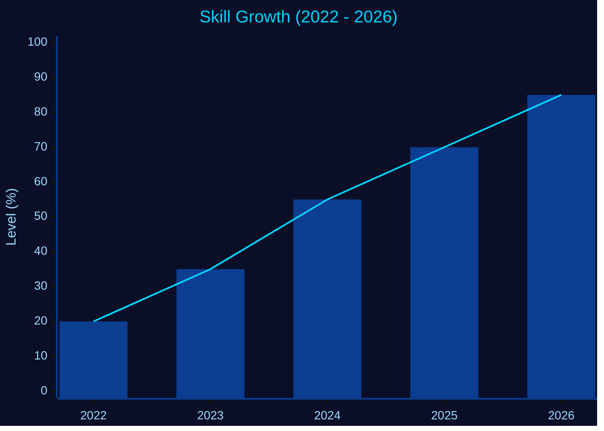
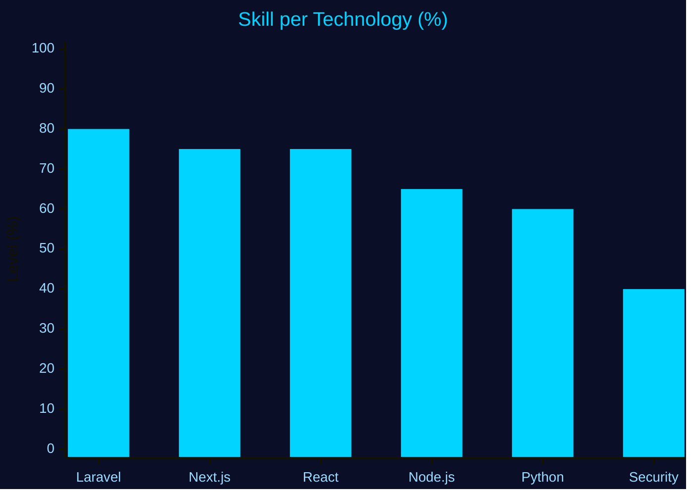

<!-- ========== HEADER 3D (WAVING) ========== -->
<p align="center">
  
</p>

<!-- ========== TYPING ANIMATION ========== -->
<p align="center">
  <a href="https://git.io/typing-svg">
    
  </a>
</p>

<p align="center">
  
  
  
</p>


## 🚀 About Me

```text
┌──[agus@dana]──[~/profile]
└──╼ $ whoami
```

| | |
|---|---|
| 🔭 **Working on** | Resto Mayo (Cashless Ordering App) & BeautyCare |
| 🌱 **Learning** | Next.js, React, Laravel, Node.js, Cybersecurity |
| 👯 **Collaborate on** | Web Development, Roblox Developers, Ethical Hackers |
| 💬 **Ask me about** | Next.js, Laravel, Python & Prisma ORM |
| 📫 **Contact** | [agusdanaadnyana33@gmail.com](mailto:agusdanaadnyana33@gmail.com) |
| ⚡ **Fun fact** | I love coding, customizing my workspace, and exploring new tools |


## 🛠 Tech Stack

<p align="left">
  
  
  
  
  
  
  
  
</p>


## 📈 Growth Chart





### 🎯 Learning Progress

| Skill | Progress |
|---|---|
| Next.js |  |
| Laravel |  |
| Node.js |  |
| Cybersecurity |  |


## 📊 GitHub Stats

<p align="center">
  
  
</p>

<p align="center">
  
</p>

### 🌐 Contribution Activity Graph

<p align="center">
  
</p>

### 🧊 3D Contribution Calendar

<p align="center">
  
</p>

<!-- ========== FOOTER ========== -->
<p align="center">
  
</p>
